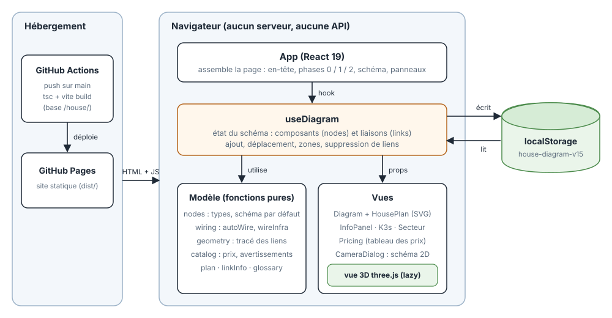

# House – schéma et budget d'un système de caméras

**Live : <https://mathieujullien77190.github.io/house/>**

Petit site React + TypeScript (Vite, Tailwind, three.js) pour dessiner et chiffrer un système de
vidéosurveillance de maison : plan interactif sur deux étages, panneau de détail, dessin de la caméra
sélectionnée, composants à brancher au secteur et tableau des prix relié au schéma.

Tout s'exécute dans le navigateur, sans serveur ni API. Le schéma est sauvegardé dans le `localStorage`.

## Architecture



Tout tourne dans le navigateur : à chaque push sur `main`, GitHub Actions construit le site (`tsc` puis `vite build`) et GitHub Pages sert les fichiers statiques. L'état du schéma vit dans le hook `useDiagram`, qui s'appuie sur des fonctions pures (modèle, branchements, prix) et alimente les vues ; il est relu et écrit dans le `localStorage`. La vue 3D des caméras (three.js) est chargée à la demande.

## Phase 0 : une Reolink enregistrée par le PC

Le schéma de la phase 0 est dans l'application, en deux vues (matériel et logiciel).

La caméra n'a pas de prise : le switch lui envoie courant et données par un seul câble. Le PC lit son flux RTSP avec go2rtc, et un enregistreur simple (détection de mouvement, clips), House API l'interroge et sert la WebApp, qu'ouvre le téléphone ; un script House Sync l'interroge à intervalle régulier (polling, sans Mosquitto) et copie les clips sur le disque de sauvegarde (il pourra passer sur le Pi de sauvegarde). Le contrôleur Omada, pour couper le PoE d'un port, viendra plus tard.

## Démarrer

```sh
npm install
npm run dev        # http://localhost:5173
```

```sh
npm run build      # build statique dans dist/ (base /house/)
npm run lint
npm run typecheck
```

Le site est déployé sur GitHub Pages à chaque push sur `main` (`.github/workflows/deploy-pages.yml`).
